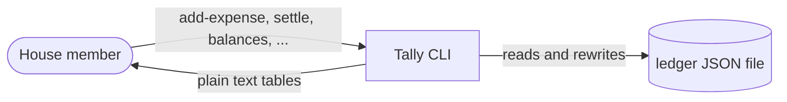
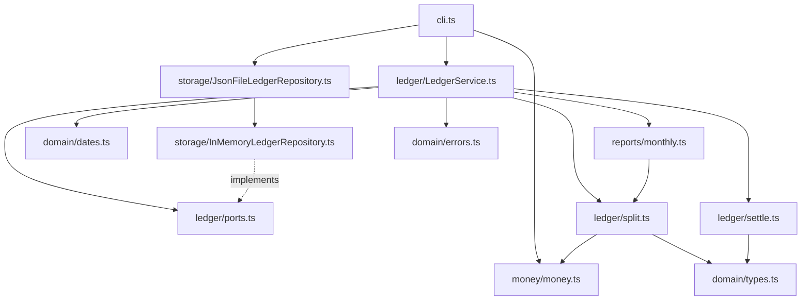

# Tally -- architecture

Handover notes. Everything here is true of the code as of this commit; where the code and
these notes disagree, fix one of them in the same pull request.

## Context

Tally keeps the shared-expense ledger for one house: who paid for what, how each expense is
split, what money has actually changed hands, and therefore who currently owes whom. It is
a command-line tool run by the members themselves on their own laptops against one shared
JSON file (in practice the file lives in a synced folder). There is no login, no server and
no concurrency story: two people writing the file at the same moment will lose one write,
and we accept that.

Out of scope, deliberately: multiple houses, currencies other than cents, bank or payment
integrations, receipts and attachments, any notion of budgets.

## Components

- **`domain/`** -- `types.ts` is the vocabulary: `Member`, `Expense` (with its `Split`
  union), `Settlement`, `Balance`, `Transfer`, and the `CATEGORIES` list. `errors.ts` is
  the single `DomainError` class; every rule violation carries a `code`. `dates.ts` keeps
  dates as ISO strings and takes the clock as a parameter so tests never depend on today.
- **`money/money.ts`** -- cents in, cents out: parse dollars, format cents, `splitEqually`.
- **`ledger/`** -- `LedgerService` is the only entry point for use cases. It validates,
  assigns ids, and calls the pure functions: `split.ts` (`sharesFor`) turns one expense
  into per-member cents; `settle.ts` (`suggestTransfers`) turns balances into a payment
  plan. `ports.ts` is the `LedgerRepository` interface the service depends on.
- **`storage/`** -- `InMemoryLedgerRepository` holds the arrays; `JsonFileLedgerRepository`
  extends it and rewrites one file after every change. Reading validates the file's shape.
- **`reports/monthly.ts`** -- one month's totals by category and by member.
- **`cli.ts`** -- argv parsing, name-to-id lookup, printing. It knows no rules.

Data flow for `balances`: the service walks every expense, credits the payer with the
amount and debits each member their share from `sharesFor`; then applies each settlement;
the result is one `Balance` per member. Nothing is cached, nothing is stored.

## Key rules

Issues and tests cite these by number.

- **R1** Money is integer cents; nothing is ever a float.
- **R2** An equal split distributes the amount so that the shares differ by at most one
  cent and sum exactly to the amount; the extra cents go to the members earliest in the list.
- **R3** An exact split's shares must sum exactly to the amount.
- **R4** A percent split's percents must be integers and sum to exactly 100. Each share is
  the floor of its exact percentage, then the leftover cents go to the largest fractional
  remainders (ties to the member earliest in the list); the shares always sum exactly to
  the amount.
- **R5** The payer may or may not be in the split.
- **R6** Balances are derived, never stored: (paid) - (owed) + (settlements received) -
  (settlements paid), per member; across the house they sum to zero.
- **R7** Settle-up suggestions minimise the number of transfers by repeatedly matching the
  largest debtor with the largest creditor (greedy); the plan need not be optimal, but it
  must zero every balance.
- **R8** A member with expenses or settlements cannot be removed; one without can.

## Decisions

- [ADR 0001: One JSON file, rewritten on every change](docs/adr/0001-single-json-file-storage.md) -- Accepted.
- `docs/adr/template.md` is the form for the next one.

## Known limitations

- **Split kinds are a closed `switch`.** `split.ts` switches on `split.kind`; adding a kind
  means editing that switch, the `Split` union in `types.ts`, the `--shares` parser in
  `cli.ts`, and the JSON shape. A `SplitStrategy` interface (one object per kind, registered
  in one place) was considered and not done; if a fourth kind arrives, that is the moment.
- **A settlement can be any size.** `settle` records whatever amount you type, even more
  than the payer owes; the balances simply flip sign. Nothing warns.
- **Settlements are append-only.** There is no edit or delete; a typo is corrected by
  recording a second settlement the other way, which leaves both in the file.
- **No recurring expenses.** Rent and the internet bill are typed in by hand every month.
- **`reports/monthly.ts` is a single pass that does everything** -- filter, group, total,
  per-member paid/owed -- keyed by strings like `"2026-11|groceries"`, with its own copy
  of the category list. It is correct and ugly.
- **`cli.ts` parses `--shares name=value` twice**, once for exact and once for percent
  splits, and has no tests of its own (it is excluded from coverage).

## Where to start reading

1. `src/domain/types.ts` -- ten minutes, then you know every noun.
2. `src/ledger/split.ts` and `tests/split.test.ts` together -- the smallest complete
   rule-plus-test pair in the repo.
3. `src/ledger/LedgerService.ts` -- read `addExpense` and `balances`; the rest follows the
   same shape.
4. `src/cli.ts` -- only when you need to add a command; copy the shape of `cmdSettle`.
